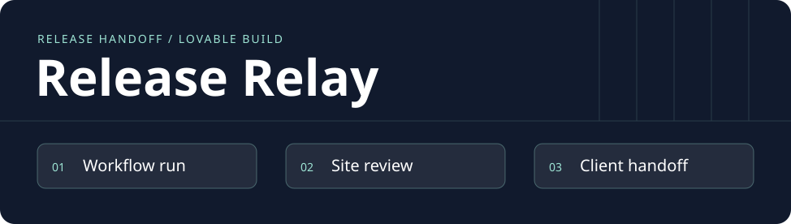
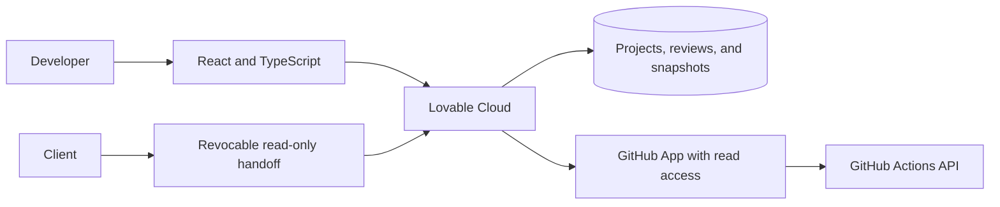

# Release Relay

**English** · [Português](README.pt-BR.md) · **Status · local contract demo and Lovable build brief**

[](https://github.com/acamilateixeira/release-relay/actions/workflows/ci.yml)

[Project Wiki](https://github.com/acamilateixeira/release-relay/wiki) · [Versioned documentation](docs/wiki/Home.md)

**Give clients one link that tells them what shipped, what you checked, and what comes next.**

A freelancer shipping a small site has to piece together the GitHub run, the live URL, and the checklist before sending an update. Release Relay puts that evidence in one handoff. The first walkthrough will use [Sorteador](https://acamilateixeira.github.io/sorteador-web/), an Angular app already deployed from GitHub.

## The first release

1. Connect GitHub, pick a public repository and workflow, and pull recent runs.
2. Select a run and pin the review to its commit. Verify the site manually and record the checks.
3. Share a revocable, read-only snapshot. The recipient sees the scope, evidence, review date, and next step without an account.

The interface has three screens: projects, project details, and the handoff. Workflow result, manual site verification, and handoff publication each have their own state. Changing the commit resets the review. A green workflow alone does not establish which revision visitors are seeing.

## Proposed architecture



| Decision | Why |
| --- | --- |
| **Lovable + React/TypeScript** | Prototype empty, syncing, failed, disconnected, and ready states early. Sync the code to GitHub for review and CI. |
| **Lovable Cloud** | Managed authentication, database, secrets, functions, and hosting. Database policies enforce project ownership. |
| **GitHub App** | Limit access to selected repositories and read-only workflow metadata. Verify installation and repository access server-side. Refresh on demand and show when the data was last synced. |
| **Revocable snapshot** | Publish an explicit set of evidence for the client. The link can be disabled from the owner's workspace. |

[Lovable Cloud](https://docs.lovable.dev/features/cloud) · [Git sync](https://docs.lovable.dev/integrations/github) · [GitHub Actions API](https://docs.github.com/en/rest/actions/workflow-runs)

## What will count as done

- Import a real workflow run. Show how the product behaves when access is revoked or GitHub is temporarily unavailable.
- Demonstrate that a second account cannot read or modify the project and that a revoked handoff link stops working.
- Test whether a new user can tell which commit was reviewed, what was verified, and how to share it. Track the steps from connection to first publication and report results after actual sessions.

## Building with Lovable

Start with the [prototype prompt](docs/lovable-prompt.md), then connect Lovable Cloud and add the GitHub integration. Capture what the agent generated, what changed in review, and which tests verify the result. The live GitHub integration and Lovable deployment are planned milestones.

## Run the contract demo

Requires Node.js 22. Start the localhost fixture and run its HTTP tests.

```bash
node demo/server.mjs
# In another terminal
node --test demo/server.test.mjs
```

Import the [Postman collection](docs/postman.collection.json) into Postman or Insomnia. It lists a synthetic workflow, rejects an unverified release, publishes a handoff, and verifies that the revoked link returns 404. This fixture uses memory and a synthetic GitHub result. The Lovable project will add the product UI, authentication, and real integration.
