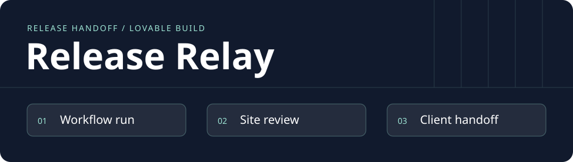
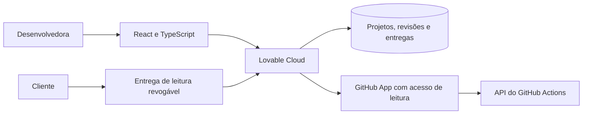

# Release Relay

[English](README.md) · **Português** · **Status · desenho de produto**

**Envie ao cliente um link que mostra o que foi entregue, o que você conferiu e qual é o próximo passo.**

Quem entrega um site precisa reunir a execução do GitHub, o endereço publicado e o checklist antes de avisar o cliente. O Release Relay reúne essas evidências em uma entrega. O primeiro roteiro usa o [Sorteador](https://acamilateixeira.github.io/sorteador-web/), um app Angular já publicado a partir do GitHub.

## A primeira versão

1. Conecte o GitHub, selecione um repositório público e um workflow e consulte as últimas execuções.
2. Escolha uma execução e vincule a revisão ao commit. Confira o site manualmente e registre os testes.
3. Compartilhe um resumo de leitura com link revogável. O cliente vê o escopo, as evidências, a data da revisão e o próximo passo sem precisar de conta.

A interface terá três telas: projetos, detalhe do projeto e entrega. Resultado do workflow, verificação manual do site e publicação da entrega têm estados próprios. Trocar o commit reinicia a revisão. Uma execução verde, por si só, não comprova qual versão está no ar.

## Arquitetura proposta

| Decisão | Motivo |
| --- | --- |
| **Lovable + React/TypeScript** | Prototipar estados vazio, sincronizando, falha, desconectado e pronto para entrega. Sincronizar o código com GitHub para revisão e CI. |
| **Lovable Cloud** | Usar autenticação, banco, segredos, funções e hospedagem gerenciados. Políticas no banco garantem o acesso por dono do projeto. |
| **GitHub App** | Limitar o acesso aos repositórios selecionados e à leitura dos metadados do workflow. Validar instalação e acesso no servidor. Atualizar sob demanda e exibir quando os dados foram sincronizados. |
| **Resumo revogável** | Publicar um conjunto explícito de evidências para o cliente. A responsável pelo projeto pode desativar o link. |

[Lovable Cloud](https://docs.lovable.dev/features/cloud) · [Sincronização Git](https://docs.lovable.dev/integrations/github) · [API do GitHub Actions](https://docs.github.com/en/rest/actions/workflow-runs)

## O que precisa funcionar

- Importar uma execução real. Mostrar o que acontece se o acesso for revogado ou o GitHub ficar temporariamente indisponível.
- Demonstrar que uma segunda conta não consegue ler nem alterar o projeto e que o link revogado para de abrir.
- Observar se uma pessoa identifica o commit revisado, entende o que foi conferido e consegue compartilhar. Medir os passos entre conexão e primeira publicação e registrar resultados após sessões reais.

## Desenvolvimento com Lovable

Começar pelo [prompt do protótipo](docs/lovable-prompt.md), conectar o Lovable Cloud e adicionar a integração. Registrar o que a IA gerou, o que mudou na revisão e quais testes confirmam o resultado. Hoje o repositório contém o desenho do produto e o roteiro de implementação. Os comandos de execução e a demo entram com o primeiro marco funcional.
