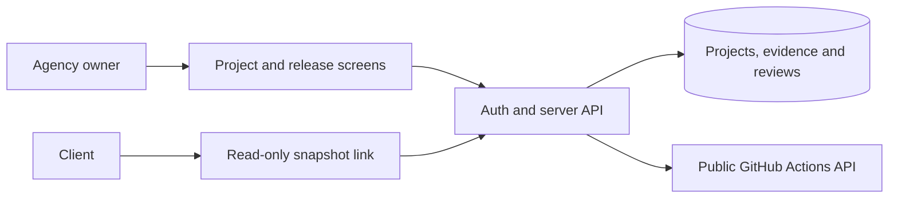

# Architecture and data

The public repository contains a small Node HTTP fixture and a collection that exercises the handoff contract. The product uses a React and TypeScript interface generated in Lovable. The target architecture uses Lovable Cloud for authentication, owner-scoped data and server functions.

| Record | Fields that matter |
| --- | --- |
| Project | Owner, project name, repository, workflow or branch, live URL. |
| Workflow run | GitHub ID, conclusion, full commit SHA, workflow link, provider timestamp and last sync time. |
| Review | Project, run identity, checklist, review timestamp, next step. |
| Handoff | Snapshot of allowed fields, a random share token, publication and revocation timestamps. |

Keep GitHub metadata separate from manual review. The server verifies ownership and review completeness before publication. A share reader resolves a token and projects only public snapshot fields. Drafts and owner-only data stay behind auth.

See [Security and privacy](Security-and-privacy.md) for policy checks and [GitHub integration](GitHub-integration.md) for how evidence is collected.
